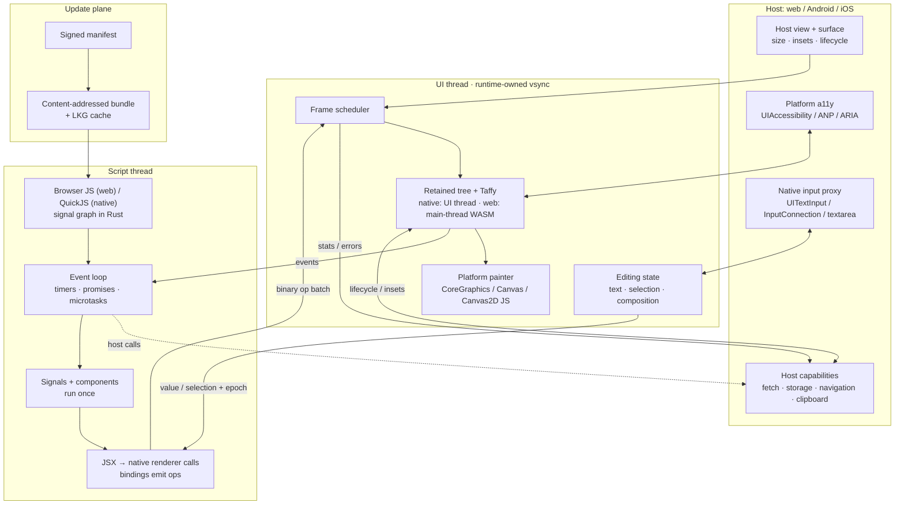
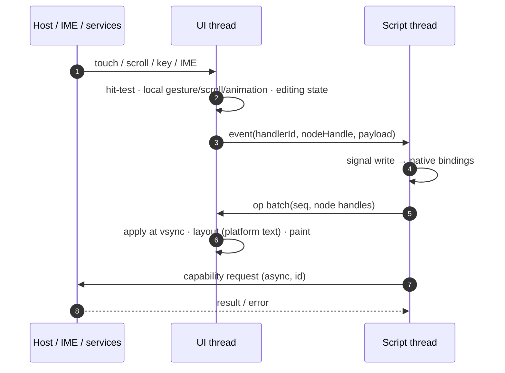

# 01 · 总览

## 1. 目标

Bubble Shell 是一个可嵌入宿主 App 的自绘 UI 运行时，用来承载**远程更新、带交互**的动态内容，定位接近 WebView，但不依赖 Web 渲染。

- **自绘**：布局、动画、命中、绘制由 runtime 控制。Web 宿主用 Canvas2D，iOS 用 CoreGraphics，Android 用 Canvas。
- **跨端**：同一份 bundle 与脚本运行在 web / Android / iOS。文本允许平台差异。
- **远程更新**：签名 bundle、内容寻址、原子激活、last-known-good 回滚。
- **交互完整**：事件、手势、滚动、动画、文本输入、焦点、无障碍。
- **可嵌入**：宿主提供 surface、能力和导航；runtime 自持 vsync；v1 单实例。

### 设计前提

- 内容由第一方团队编写、发布前审核；v1 不实现能力授权弹窗。
- 远程包必须验签；第一方信任不等于接受未签名内容。
- 文本整形、换行、bidi、字体回退由平台负责；接受三端布局差异。
- 字体由宿主注入，runtime 不自带字体。

## 2. v1 非目标

- 多实例、差量更新、grid/完整 CSS、高级视觉效果（模糊、滤镜、液态玻璃）。
- 宿主原生组件嵌入、能力授权 UI、统一调试器、桌面端。
- 跨端像素级一致；文本布局差异是明确接受的。

## 3. 架构总览

关键点：

- native：脚本线程拥有应用状态并产出 op；UI 线程的保留树是唯一视觉树，本地做动画、手势、滚动、命中与文本编辑，不等脚本。
- Web：没有 Worker。浏览器 JS 与一份 WASM 都在主线程（信号图、树、布局、命中、滚动）。绘制仍是 JS 回放 `PaintCmd`。脚本长任务卡住该帧，不另做让出。
- 宿主能力全部异步；脚本线程不直接碰 DOM、原生 UI 或画布。

## 4. 一次交互

事件延迟由“UI 命中 + 跨线程排队 + 脚本处理 + 下一帧提交”构成；文本输入与滚动例外，它们在 UI 线程本地完成，避免每键/每帧跨线程。

## 5. 关键决策

| 维度 | v1 定稿 |
|---|---|
| 信任边界 | 第一方内容；Ed25519 签名包；能力权限 v1 先 ambient，桥接点保留 |
| 作者模型 | TSX 函数组件；Oxc 把 JSX 降成原生渲染调用；信号图在 Rust；组件只跑一次；细粒度绑定；无 VDOM、无模板 IR、无预编译子树 |
| 脚本运行时 | native：QuickJS/PrimJS。Web：主线程浏览器 JS 调 Rust 信号图（WASM）。不在 JS 里实现信号 |
| 线程 | native：脚本线程产 op，UI 线程持有树并布局。Web：单线程；无 Worker、无跨线程 op |
| 核心 | Rust 保留树 + Taffy flex；平台文本/绘制；无高级合成 |
| 文本 | 平台全权（整形、换行、bidi、回退）；接受三端差异；字体宿主注入 |
| 输入 | UI 线程编辑状态 + 平台原生输入代理；iOS/Android 原生手柄与菜单 |
| 无障碍 | Rust 语义树 + 平台桥 + Web ARIA 覆盖层 |
| 嵌入 | 单实例；宿主导航；runtime 只发 navigation intent |
| 更新 | 签名 manifest + 内容寻址 + 整包原子激活 + LKG；宿主决定 activate/defer |
| 验收 | 首帧 <400ms；常规 60fps、复杂列表 30fps+；事件 P95 <32ms；内存 +<100MB；Web <3MB gz |

## 6. 验收指标

| 指标 | v1 门槛 | 说明 |
|---|---|---|
| 冷启动首帧 | <400ms | 验签完成到首帧；含引擎初始化 |
| 常规页面 | 60fps | 约 1k 节点、常规动画 |
| 复杂列表 | 30fps+ | 虚拟化滚动 |
| 脚本单事件 | P95 <32ms | 不含异步宿主调用 |
| 内存增量 | <100MB | 单实例，含 QuickJS/WASM |
| Web 包 | <3MB gzip | runtime + 引擎胶水，不含业务 bundle |
| 更新回滚 | 自动 | 新包挂载失败 N 秒内回 LKG |
| 无障碍 | 核心路径可用 | VoiceOver / TalkBack / NVDA |

## 7. 术语

| 术语 | 含义 |
|---|---|
| Bundle | 远程内容包：manifest + 应用 ES 模块 + 资源。运行时（信号图、渲染器）不打进包 |
| Manifest | 版本、兼容性、文件哈希、签名等元数据 |
| 渲染调用 | 编译器产出的 `rt` 调用：建节点、设静态属性、登记绑定。动态值不是 IR 槽 |
| Op | 脚本线程发往 UI 线程的细粒度变更指令 |
| Handle | 脚本线程在实例作用域内分配的 u32 节点标识；Rust 校验并持有映射 |
| LKG | Last-known-good，上一个验证通过且能正常挂载的 bundle |
| Host bridge | 脚本访问 fetch/storage/navigation 等宿主能力的异步桥 |
| Script thread | native 上跑 QuickJS 的线程，拥有应用状态。Web 没有这条线程 |
| UI thread | 跑 Rust 树、布局、绘制、动画、命中、无障碍的线程 |
