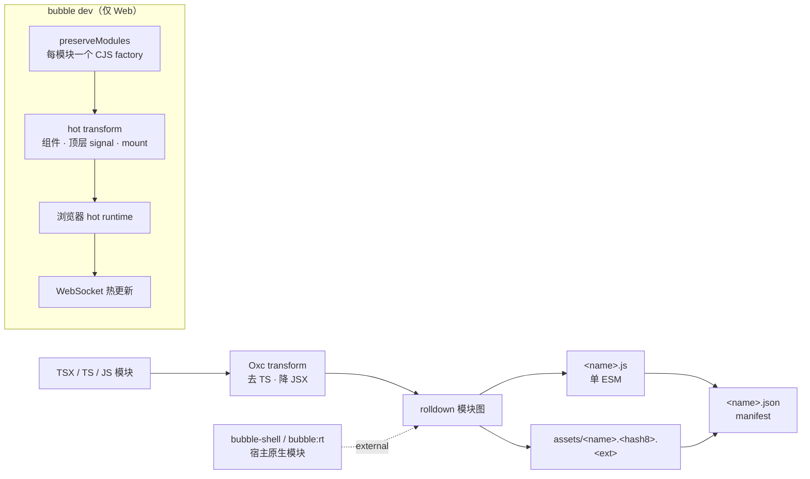

# 07 · JS 打包策略重设计

状态：已实现，2026-11-13。第 1–9 节保留为设计与迁移记录，实现偏差见第 13 节；[02-runtime.md](02-runtime.md) 同步摘要，细节或冲突处以此文为准。

## 1. 目标

把当前“单文件直译 + 手写 manifest”替换为 nsh 式的 Rust-only 打包管线：

- 作者写多模块 TSX/TS/JS；任意 JS 语句、表达式和模块导出原样保留。
- 一次 Oxc pass 只做两件事：去掉 TypeScript、把 JSX 降为渲染调用。
- rolldown 负责模块图、链接、最终输出；不引入 Node、npm、`node_modules`。
- 发布产物是单个 ES module，只含应用代码；运行时以原生模块提供，不进 bundle。
- 资源导入生成内容命名文件，bundle 通过相对路径引用。
- Web 开发态支持状态保留 HMR；native HMR 延后。
- 现有 Web/iOS/Android fixture 与交互行为保持不变。

非目标（本阶段明确不做）：

- minify、代码分割 / 动态 import chunks。
- native QuickJS 字节码。
- 发布包内的 source map。
- TypeScript 类型检查（只去类型，不运行 `tsc`）。
- JSX fragment、spread props、SVG 资源导入。
- 应用配置目录（`App.tsx` + 配置文件）；继续使用 fixture 多入口。
- native 状态保留 HMR 与 WebSocket dev host。

## 2. 决策

| 维度 | 决策 |
|---|---|
| 交付 | 先设计并落地发布打包；Web HMR 随 MVP；native HMR post-MVP |
| 链接器 | rolldown 当前稳定版（1.3.2）；Oxc 同步升级到 0.158 |
| 编译器 | 重写为 nsh 式 AST transform；保留任意 JS 与 import |
| 运行时边界 | `bubble-shell` 与 `bubble:rt` 是宿主提供的原生模块 |
| 产物 | 单 ESM；无 minify、无 split、无字节码 |
| source map | 仅 dev 产物；release 不生成、manifest 不登记 |
| 资源 | `<name>.<hash8>.<ext>`，bundle 内相对路径引用 |
| 动态绑定 | 沿用现有规则：表达式读取本地 `signal()` / `computed()` 调用即为动态 |
| 入口 | fixture 多入口；bundler CLI 接收一个或多个 entry |
| HMR | 先 Web：dev CJS 每模块一个 factory + 状态保留 hot runtime；native 整包重挂 |
| 工具 | 新增 `bubble` CLI crate：`bubble bundle` / `bubble dev` |

## 3. 管线总览



发布与开发是两条输出路径：

- 发布：单个 ESM + 资源 + manifest。
- 开发：模块保留、CommonJS factory、热补丁脚本；不进入发布包。

## 4. 编译器

`crates/compiler` 保留包名 `bubble-compiler`，内部替换为真正的模块编译器。删除现有 806 行直译器和 `src/main.rs`。

### 4.1 接口

```rust
pub struct CompiledModule {
    pub code: String,
    pub map: Option<String>,
}

pub fn compile_module(
    name: &str,
    source: &str,
    options: &CompileOptions,
) -> Result<CompiledModule, String>;
```

- `name` 决定 `SourceType`：`.tsx` / `.ts` / `.jsx` / `.js`。
- 错误返回带 code frame 的文本；不 panic。
- bundler 的 `load` / `transform` hook 调用它；单文件 CLI 不再存在。

### 4.2 转换规则

1. **解析**：Oxc parser，保留全部 span。
2. **TypeScript**：用 Oxc transformer 去掉类型；不执行类型检查。
3. **JSX**：在 AST 上替换，不做字符串拼接。
   - 宿主原语标签：`<View …>` → `__rt.primitive("View", props, children)`
   - 文本：`<Text>…</Text>` 的静态文本一次生成；动态内容生成 thunk。
   - 组件：`<Card …>` → `__rt.component(Card, props, children)`
   - 手势：`<TapGesture …>` 等 → `primitive("TapGesture", …)`
   - 控制流：`Show` / `For` / `Index` / `Switch` / `Match` 是全局标签，分别降到 `__rt.show` / `forEach` / `indexEach` / `switchFlow`。
4. **动态绑定**：表达式（属性值或文本）中出现对本地 `signal()` / `computed()` 绑定的调用，包一层 `__rt.dynamic(() => expr)`；事件处理器和函数表达式不包。
5. **导入**：应用自己的模块导入原样保留。
   - 只作为 JSX 标签使用的 `bubble-shell` 导入名在 JSX 降级后删除；仍有值引用的导入保留。
   - 自动注入 `import { primitive as __rt_primitive, … } from "bubble:rt"`，使用带前缀的别名避免与作者绑定冲突。
   - `bubble-shell` 是原生模块；rolldown 不解析、不打包它。
6. **导出**：`export` / `export default` / 顶层任意语句原样保留；不再只接受“函数声明 + `mount()`”。
7. **Source map**：Oxc codegen 生成模块级 map；rolldown 合并。发布构建可关闭 map 生成。

### 4.3 语法边界

本阶段仍然拒绝并给出明确错误：

- JSX fragment。
- JSX spread props。
- 无法识别的标签/原语。
- 导入原生模块中不存在的命名导出。
- 非 `.tsx/.ts/.jsx/.js` 入口。

分析语义沿用现有规则：本地 `const x = signal(...)` / `computed(...)` 才进入信号集合；跨模块导出的 signal 不进集合。需要响应式的值用显式 `dynamic()`。

## 5. 运行时模块边界

### 5.1 模块

| specifier | 用途 | 内容 |
|---|---|---|
| `bubble-shell` | 作者 API | `signal`、`computed`、`effect`、`batch`、`cleanup`、`mount`、`dynamic`、`registerPrimitive` 及现有公开导出 |
| `bubble:rt` | 编译器专用 | `primitive`、`component`、`dynamic`、`show`、`forEach`、`indexEach`、`switchFlow`、`setProp`、`bindProp` |
| `bubble:hot` | 仅开发 bundle | `__bubble_hot` 的组件、context、keep、mount 注册入口 |

`bubble-shell` 与 `bubble:rt` 必须是**同一个运行时实例**：

- native：rquickjs loader 把两个 specifier 规范化为同一个模块 id，返回同一份源码。
- Web：import map 把两个 specifier 指向同一个 URL；浏览器只求值一次。

### 5.2 运行时源码

- 单一来源：`crates/native/js/runtime.js`（从 `examples/web/runtime.js` 迁入）。
- native：`include_str!` 嵌入，由 loader 作为 `bubble-shell` 提供。
- Web：`examples/build-fixtures.sh` 复制到 `examples/web/runtime.js`；页面通过 import map 使用。
- Web SDK 源码在 `sdk/web/src/`；同一份运行时的构建副本在 `sdk/web/dist/runtime.js`（gitignored）。`host.js` 用 `bubble-shell` 裸导入，由页面 import map 解析到运行时，不依赖 `dist/` 的相对路径。
- `bubble:rt` 不复制源码；由 loader / import map 解析到同一模块。

### 5.3 native loader

- `crates/native` 的 `rquickjs` 启用 `loader` feature。
- `make_vm` 安装 resolver / loader：
  - `bubble-shell`、`bubble:rt` → `RUNTIME_JS`
  - 其他裸 specifier → 明确错误
  - 发布 bundle 不应有相对导入；出现即报错
- `install_and_run` 改为：
  1. 绑定宿主 API。
  2. 求值 `bubble-shell` 运行时一次。
  3. 求值入口 bundle（`main.js` 或 `<fixture>.js`）。
  4. 保持现有的 watchdog、内存限制、fault 重建路径。
- `bubble_load(manifest, entry)` 的外部签名不变；入口字节仍是 bundle 源码。

### 5.4 Web loader

- `examples/web/index.html` 增加 import map：

```html
<script type="importmap">
{
  "imports": {
    "bubble-shell": "./runtime.js",
    "bubble:rt": "./runtime.js"
  }
}
</script>
```

- 发布页面由打包器生成同一份 import map；映射目标可以带内容哈希。
- 开发页由 `bubble dev` 提供 import map，并额外映射 `bubble:hot`。

## 6. 产物与 manifest

### 6.1 目录

```text
<out>/
  counter.js
  counter.json
  assets/
    logo.1a2b3c4d.png
```

- bundle 文件名来自入口名；manifest 的 `entry` 指向它。
- 多个 fixture 可共享同一个 `assets/` 目录；内容相同的资源只落一份。
- 资源哈希：SHA-256 前 8 位十六进制。命名冲突且内容不同 → 构建失败并列出两个源文件。

### 6.2 资源导入

```tsx
import logo from "./logo.png";

<Image src={logo} width={64} height={64} />
```

- 导入值是一个字符串：`"assets/logo.1a2b3c4d.png"`，相对 bundle 根。
- 支持栅格图片扩展名（`.png`、`.jpg`、`.jpeg`、`.gif`、`.webp`）；其他扩展名报错。
- 资源文件随构建复制到输出目录；manifest 的 `assets` 登记路径、SHA-256、大小。
- native 宿主把 bundle 根目录作为资源根；Web 宿主以**当前 bundle 的 URL**为 base 解析相对路径，而不是 `document.baseURI`。绝对 URL、`data:` 等原有 `src` 形式不变。

### 6.3 manifest

保持现有 schema，新增可选的 `assets` 数组：

```json
{
  "schema": 1,
  "id": "com.bubble.counter",
  "version": 1,
  "minRuntime": "0.1.0",
  "platforms": ["web", "ios", "android"],
  "entry": "counter.js",
  "files": [
    { "path": "counter.js", "sha256": "...", "size": 6789 }
  ],
  "assets": [
    { "path": "assets/logo.1a2b3c4d.png", "sha256": "...", "size": 1024 }
  ],
  "keyId": "m0-placeholder",
  "signature": "m0-placeholder"
}
```

- `files` 只列出 `bubble_load` 实际接收并在激活时校验的文件；当前就是入口 bundle。这样 `validate_bundle_hashes` 与现有 native ABI 不需要改变。
- `assets` 是被签名覆盖、但由宿主按需解析的资源。native 在加载 `src` 时按 bundle 根读取，并可用 `sha256` 校验；Web 通过相对 URL 获取。
- 签名对象与验签规则不变；`assets` 同样属于签名对象。
- release 不写 source map，因此 manifest 不出现 `.map`。
- dev 输出 `<entry>.js.map`，不写 manifest，由 dev server 直接提供。

## 7. CLI

新增 `crates/cli`，包名 `bubble-cli`，二进制 `bubble`。

```sh
bubble bundle examples/app/fixtures/counter.tsx --out examples/web/fixtures \
  --id com.bubble.counter

bubble bundle examples/app/fixtures/*.tsx --out examples/web/fixtures
bubble dev examples/app/fixtures/counter.tsx --port 4173
```

- `bundle`：
  - 接收一个或多个 entry。
  - 从文件名推导 id（可被 `--id` 覆盖）；`version`、`platforms`、`minRuntime` 有默认值。
  - 写 bundle、资源、manifest。
  - 默认 release；`--dev` 只供 `dev` 内部使用。
- `dev`：
  - 启动 HTTP + WebSocket 服务。
  - 首次构建 dev bundle。
  - 监听 entry 及其依赖；变更后发送热补丁。
- `examples/build-fixtures.sh` 改为调用 `cargo run -q -p bubble-cli -- bundle …`，删除手写 Python manifest。
- 现有 `bubble-compiler` 二进制删除；`cargo run -p bubble-compiler` 不再是构建入口。

## 8. 开发态 HMR（先 Web）

### 8.1 构建

- rolldown `preserve_modules` 输出每模块一个 CommonJS chunk。
- 每个 chunk 包装为 `__bubble_hot.define(id, factory)`。
- 入口额外导入 `bubble:hot`。
- hot transform 在 JSX 降级前标记：
  - 顶层大写函数组件 / 箭头组件；
  - 顶层 `mount(...)` 的组件；
  - 顶层 `const x = signal(...)` / `computed(...)`；
  - 顶层 `context()`（如后续引入）。
- 组件注册为稳定 proxy；模块重跑时替换实现，已挂载实例按签名决定是否重渲染。

### 8.2 浏览器运行时

- `__bubble_hot` 维护模块 factory、exports、importers、组件 proxy、keep 表、mount 记录。
- 热补丁是一个 ES module，调用 `__bubble_hot.update(...)`。
- 补丁无法应用时返回 false，dev server 让页面整页重载。
- 复用现有 `runtime.js` 的信号与渲染实例；不重启 WASM。

### 8.3 服务端

- 监听文件变化，重新构建。
- 先尝试只发送变更模块；失败则发送完整 dev bundle 并让页面重载。
- 控制台输出构建错误；页面显示覆盖层错误。

### 8.4 验收

- 修改 `Counter` 的文本后页面更新，`Count` 值保留。
- 修改 `signal` 初始值后只重建对应模块；无法保留时明确回退到整页重载。
- native 不在本阶段接入 WebSocket；native 开发仍按现有“重新打包 + 重启”路径。

## 9. 迁移步骤

按顺序落地，每步保持 workspace 可编译：

1. **依赖**：`crates/compiler` 升级 Oxc；采用当前最新版本，不刻意对齐 nsh：`rolldown = "=1.3.2"`、`oxc = "=0.158.0"`、`rolldown_common = "=1.3.2"`、`rolldown_error = "=1.3.2"`、`rolldown_sourcemap = "=1.3.2"`、`string_wizard = "=1.3.2"`、`oxc_sourcemap = "=10.0.0"`。精确固定是为了可复现，不代表跟随 nsh 的版本。
2. **编译器**：重写 `crates/compiler`；移植现有 lower 测试的语义断言；删除 `src/main.rs`。
3. **bundler**：新增 `crates/bundler`（`bubble-bundler`）：
   - `plugin.rs`：resolve / load / transform / render_chunk；
   - `bundle.rs`：release 与 dev 两种输出；
   - `assets.rs`：导入、哈希、复制；
   - `hot.rs`：开发态 transform。
4. **运行时**：把 `runtime.js` 迁到 `crates/native/js/`；native 安装 loader；Web 增加 import map 与复制步骤。
5. **CLI**：新增 `crates/cli`；改写 `examples/build-fixtures.sh`；删除旧 manifest 生成脚本。
6. **Web HMR**：新增 dev server、`hot.js`、WebSocket 协议；接入 `bubble dev`。
7. **示例**：`sdk/web/src/host.js` 改为加载构建产物；fixture 页面用 import map；加一个带图片资源的 fixture 验证 assets。
8. **文档**：更新 `docs/README.md` 索引；实现完成后改写 `docs/02-runtime.md` 第 1–2 节、`docs/04-risks-roadmap.md` 的 MVP/里程碑描述。
9. **清理**：删除旧直译器、`../runtime.js` 路径、手写 fixture manifest、`examples/web/fixtures/*.js` 中由旧编译器生成的产物。

## 10. 验证

只使用仓库允许的窄验证：

```sh
cargo check --workspace
cargo test --workspace
node --test examples/web/*.test.mjs
sh examples/build-fixtures.sh
```

新增测试：

- `bubble-compiler`：多模块输入保留任意语句/导出；JSX 降级；动态绑定；导入消除；错误 code frame。
- `bubble-bundler`：两个模块 + 一个资源生成单 ESM、manifest、命名资源；bundle 不含 runtime 源码；native 模块导入保留为 specifier。
- `bubble-ffi`：rquickjs loader 能把 `bubble-shell` / `bubble:rt` 解析到同一模块，并执行一个最小 bundle。
- Web：现有 Node 单测保持通过；手动 smoke 覆盖渲染、点击、滚动、输入、焦点。
- HMR：`bubble dev` 手动 smoke；不新增浏览器自动化 harness。
- iOS/Android：现有可选模拟器入口加载同一 fixture，确认导入改动没有破坏 native 启动。

不做：golden/screenshot、性能门禁、设备矩阵、真实读屏、字节码兼容测试。

## 11. 风险与延后

| 风险 | 影响 | 缓解 |
|---|---|---|
| Oxc `0.61 → 0.158` 的 AST/API 变动 | 编译器重写成本 | 先独立完成编译器与测试，再接 bundler |
| rolldown 依赖体积与构建时间 | 开发机与 CI 变慢 | 只作为构建依赖；测试用最小 fixture；不在运行时链接 |
| import map 与签名包激活的配合 | 发布页面需在加载 bundle 前注入映射 | MVP 先由 demo 页面静态提供；打包器集成列入 post-MVP |
| native 资源根与 bundle 根不一致 | 图片加载失败 | 构建脚本把 `assets/` 复制到宿主资源同一目录；native 以 bundle 根解析 |
| HMR 状态保留的边界 | 某些编辑只能整页重载 | 补丁失败返回 false 并重载；文档明确 |
| 原生模块导入未处理 | 浏览器报 bare specifier 错误 | import map 由页面/打包器保证；native loader 明确报错 |

post-MVP：

- native 状态保留 HMR + WebSocket dev host（当前 Web host 已落地，native 仍重新打包重启）。
- QuickJS 字节码与版本锁定。
- minify、split / 动态 import chunks。
- 发布 source map 或错误符号化。
- JSX fragment、spread props、SVG 资源、类型检查。
- 应用配置目录与多入口发布。

## 12. 验收

实现完成时：

- `cargo check --workspace`、`cargo test --workspace`、`node --test examples/web/*.test.mjs` 通过。
- `sh examples/build-fixtures.sh` 生成 `counter`、`editing`、`focus`、`gestures` 的 bundle、manifest 与资源（如有）。
- 生成的 `counter.js` 只含应用代码与 `bubble-shell` / `bubble:rt` 导入，不含 `runtime.js` 内容。
- Web 页面加载 bundle 后完成点击、滚动、文本输入与焦点移动。
- 新增资源 fixture 能从 `assets/<name>.<hash8>.<ext>` 加载图片。
- native 模拟器加载同一 bundle 并完成一次点击/滚动/输入。
- `bubble dev` 下修改组件文本，页面更新且计数状态保留。

## 13. 实现结果与偏差

落地内容与本文一致的部分不再重复；下面是实现时定下的细节和仍然存在的差距。

### 13.1 版本

- `oxc = "=0.158.0"`，`rolldown = "=1.3.2"`，`rolldown_common/plugin/sourcemap = "=1.3.2"`。
- `oxc_sourcemap` 由 `oxc_codegen 0.158` 传递依赖到 `9.0.0`，没有单独固定到 10：只有 bundler 把编译器的 map JSON 解析成 `SourceMap<'static>` 时才间接使用。
- 编译器不再依赖 `string_wizard`；它只做 AST 与 codegen。

### 13.2 编译器

- 入口是 `compile_module(name, source, options)`；`CompileOptions { source_map, hot }`。
- JSX 降级在 AST 上完成，注入 `import { primitive as __bubble_rt_primitive, … } from "bubble:rt"`。
- `bubble-shell` 与 `bubble:rt` 的未使用导入按名字引用计数删除；两者指向同一宿主模块。
- 信号集合按词法作用域收集，闭包继承外层集合；导出的顶层 signal 不进集合。
- 代码帧按 `file:line:column` 输出，作为 bundler 的 `load` 错误文本。

### 13.3 开发态 HMR

- `build_dev` 用 `preserve_modules + Cjs` 得到每模块一个 factory；`render_dev_bundle` 生成模块表并 `__bubble_hot.define/run`。
- 浏览器端 `crates/cli/js/hot.js` 就是 `bubble:hot`：模块注册表、稳定组件 proxy、`keep` 表、mount 记录与 WebSocket 客户端。
- 热补丁只携带**代码有变化的模块**；新增/删除模块或补丁执行失败时整页重载。
- 服务端每次变化重新跑完整 rolldown 构建，再按模块 diff 决定发送范围；“只重建对应模块”指的是浏览器只重跑变化模块，不是增量编译。
- 更新后重新 `mount` 同一组件代理：渲染状态清空，信号值按分配顺序快照/恢复，因此计数等状态保留。
- 构建失败时发送 `error` 消息，页面显示覆盖层；下一次成功且无模块变化时发送 `clear`。
- 开发态 source map 尚未接入：模块 factory 与拼装后的 dev bundle 都没有 map，`bubble dev` 只提供代码。

### 13.4 其余差距

- 发布页面的 import map 仍由页面静态提供（`examples/web/index.html`），未做成打包器输出。
- 资源在 Web 已验证（`media` fixture + `assets/logo.<hash8>.png`）；native 目前没有图片绘制路径，`Image` 只在 Web 落地。
- `bubble dev` 的静态根默认 `examples/web`，可用 `--root` 覆盖；dev 页面由服务器生成，复用 `host.js`。
